<!-- Animated hero: Clawd (Claude mascot) typing on a laptop on top of the name -->

  

---

## `01` / About

> **Building with intent. Improving through iteration.**

I'm exploring software development by turning ideas into practical projects, experimenting with solutions, and learning through the process of building.

- **Focus:** Software development and practical problem-solving
- **Approach:** Build, test, refine, repeat

<!--
## `02` / Technology Stack

Uncomment this section and put your real stack in the URL (names from https://skillicons.dev),
for example: ?i=python,js,git,vscode

## `03` / Featured Projects

| Project | Description |
| --- | --- |
| [project-name](https://github.com/oTheShad4w/project-name) | What it does in one sentence |
-->

 

*Less noise. Better solutions.*

